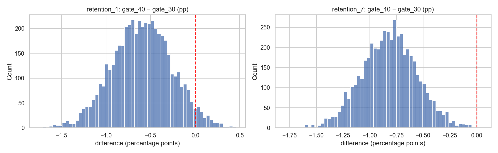
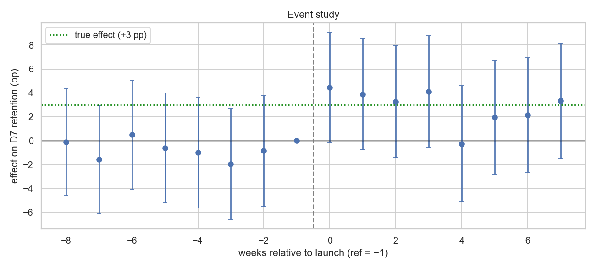

# Product Analytics Methods: A/B Testing, Difference-in-Differences, SQL Data Quality, KPI Analysis

This repository re-creates, on **public and simulated data**, the analytical workflow I used as a Market Analysis Intern at **Quantumera AI** (Sep 2025 – Jan 2026). That work covered experiment analysis, causal estimation with Difference-in-Differences, SQL data-quality monitoring and product KPI reporting.

> **About the data:** the original company data and code are proprietary and are **not** included or reproduced here. Nothing in this repository is derived from company data. The A/B test uses a public dataset. Everything else uses data **simulated** by [`src/simulate_product_data.py`](src/simulate_product_data.py), with known "ground-truth" effects and injected defects, so each method can be checked against the right answer. Results here are not the results from my internship.

**Stack:** Python · pandas · SciPy · statsmodels · DuckDB (SQL) · matplotlib / seaborn · Jupyter

---

## 1 · A/B test analysis: [`01_ab_test_retention.ipynb`](notebooks/01_ab_test_retention.ipynb)
**Public data:** the *Cookie Cats* mobile-game experiment (90,189 players randomized to a progress gate at level 30 vs. level 40).

| Step | Method |
|---|---|
| Sanity checks | Sample-ratio-mismatch χ² test, duplicate IDs, outlier inspection |
| Effect estimation | Two-proportion z-test with a 95% CI on the difference, plus a bootstrap CI |
| Guardrail | Engagement compared with Mann-Whitney U (heavy-tailed metric) |
| Power | Minimum detectable effect and required sample size |

**Result:** moving the gate to level 40 lowers **7-day retention by 0.82 pp** (19.0% → 18.2%, p = 0.002; 95% CI −1.33 to −0.31 pp). 1-day retention shows no significant change. **Recommendation: keep the gate at level 30.**



## 2 · Difference-in-Differences: [`02_did_feature_rollout.ipynb`](notebooks/02_did_feature_rollout.ipynb)
**Simulated data:** a feature launches in 2 of 4 regions, on top of a product-wide upward trend. The **true effect is +3.0 pp** on D7 retention.

| Estimator | Estimate (pp) |
|---|---|
| Naive before/after (treated regions only) | +5.1 (biased by the time trend) |
| Naive treated vs. control (post period only) | +7.0 (biased by baseline differences) |
| **DiD, region and week fixed effects + controls** | **+3.6** (95% CI 1.9 to 5.3) ✓ covers the truth |

Parallel trends are checked with an **event study**: the pre-launch coefficients are jointly zero (p = 0.97). A **placebo launch date** shows no effect (−0.5 pp, p = 0.67).



## 3 · SQL data-quality checks: [`sql/data_quality_checks.sql`](sql/data_quality_checks.sql)
**15 validation rules** in three groups:
- **Completeness:** null keys, a missing daily partition.
- **Consistency:** duplicates, orphan foreign keys, values outside the tracking plan, invalid revenue, events before signup.
- **Timeliness:** future timestamps, late-arriving data, clock skew.

They run in DuckDB via [`src/run_dq_checks.py`](src/run_dq_checks.py). Run on the simulated raw tables with injected defects, **every planted defect is caught with the exact count**. The clean tables pass all 15 rules ([report](reports/dq_report_raw.csv)).

```
rule  dimension     description                                       failed_rows
C1    completeness  Event has no user_id                                       25
C4    completeness  Calendar day with zero events (missing partition)           1
K3    consistency   Event references a user that does not exist                30
K8    consistency   Event occurs before the user's signup                      35
T2    timeliness    Event ingested more than 24h after it occurred             60
...   (15 rules: 13 fail on raw data, 0 fail on clean data)
```

## 4 · KPI analysis and onboarding → retention: [`03_product_metrics.ipynb`](notebooks/03_product_metrics.ipynb)
- Computes dashboard KPIs (DAU, onboarding completion, D1/D7 retention, feature adoption, conversion, ARPU), broken down by acquisition channel and signup cohort.
- **Onboarding completion and D7 retention:** +9.7 pp at the user level after controlling for channel, region, platform and cohort (odds ratio 1.78). The cohort-level relationship is much noisier. The analysis is explicit that this is observational, and it recommends a randomized onboarding test.
- Metric definitions live in a shared **[KPI dictionary](docs/kpi_dictionary.md)**: numerator, denominator, cohort maturity and data-quality dependencies.

---

## Run
```bash
pip install -r requirements.txt
python data/download_cookie_cats.py      # public A/B-test data
python src/simulate_product_data.py      # simulated users + events (seeded, reproducible)
python src/run_dq_checks.py              # SQL data-quality report
jupyter notebook notebooks/
```

## Structure
```
├── data/download_cookie_cats.py
├── src/
│   ├── simulate_product_data.py   # simulated data with planted effects and defects
│   └── run_dq_checks.py           # runs the SQL rules in DuckDB
├── sql/data_quality_checks.sql    # 15 validation rules
├── notebooks/                     # 01 A/B test · 02 DiD · 03 KPIs & onboarding
├── docs/kpi_dictionary.md
├── reports/dq_report_raw.csv
└── figures/
```
